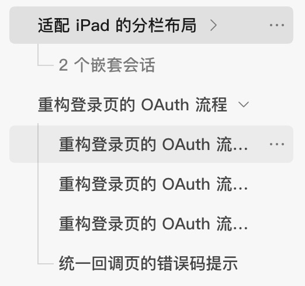
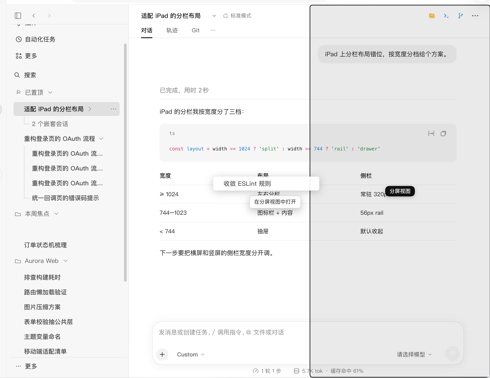
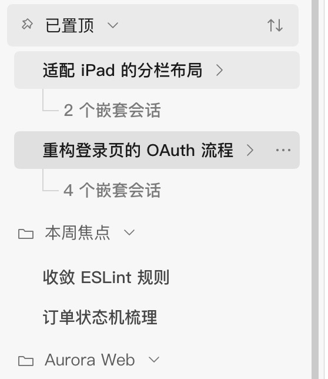
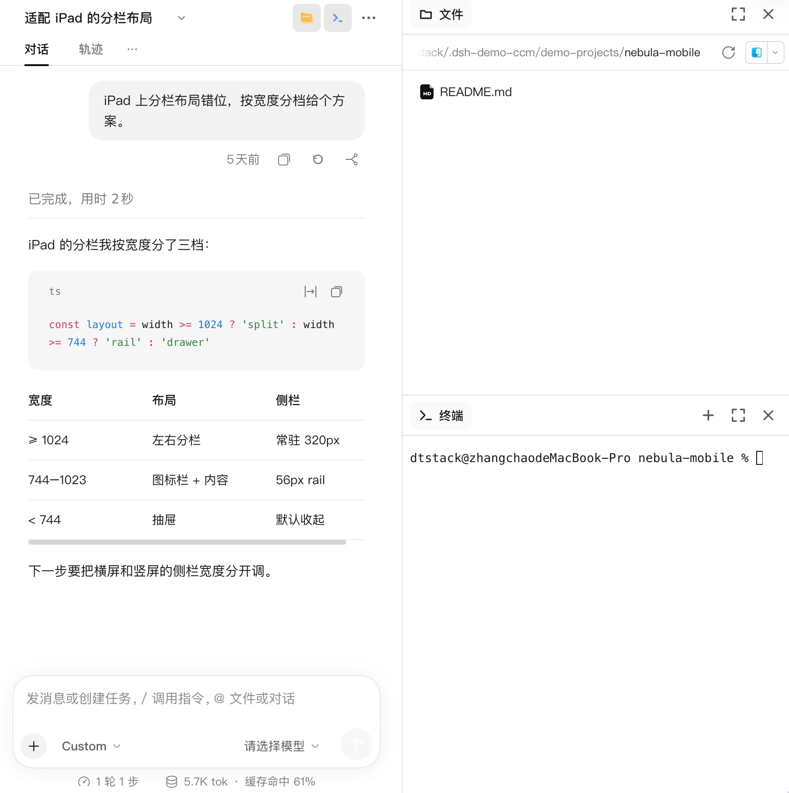
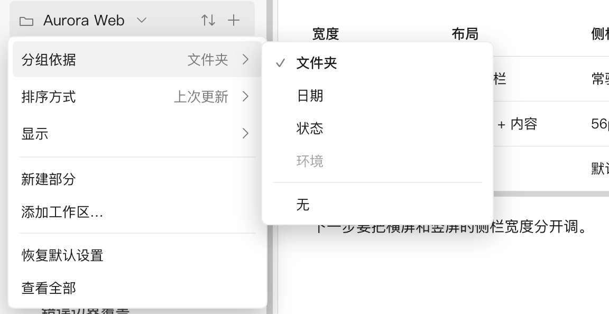
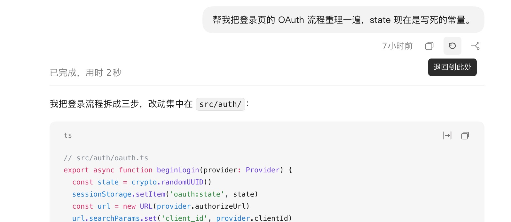
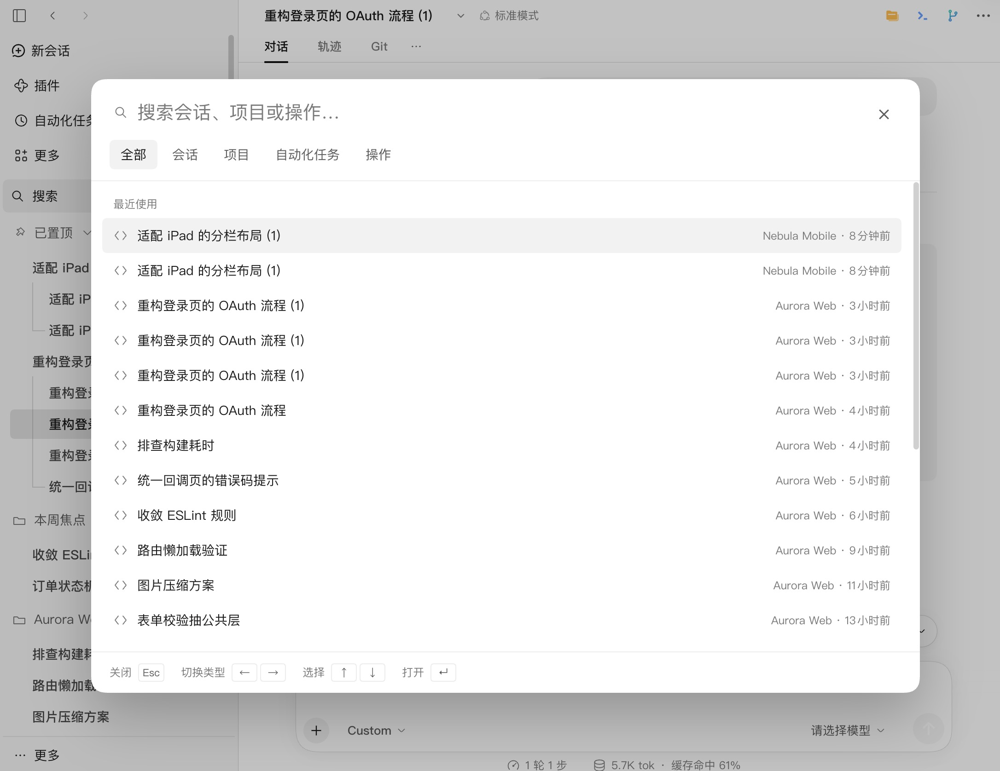
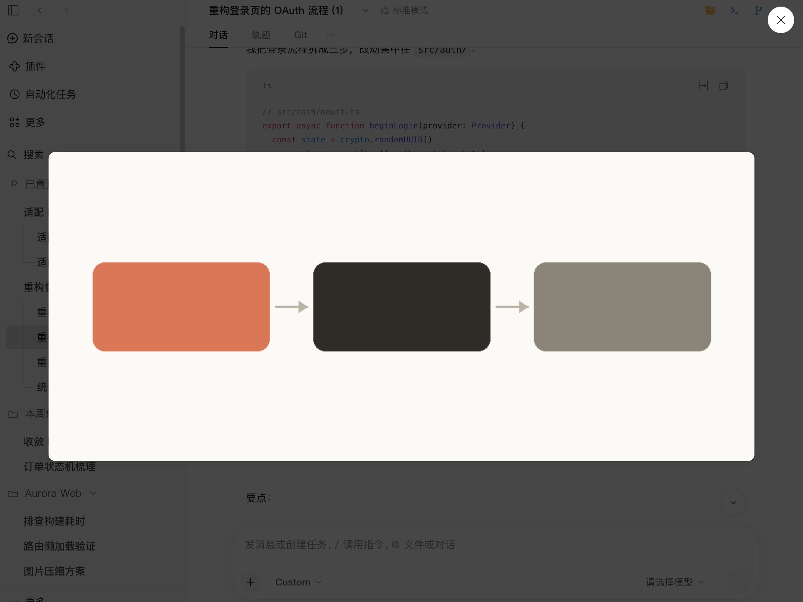
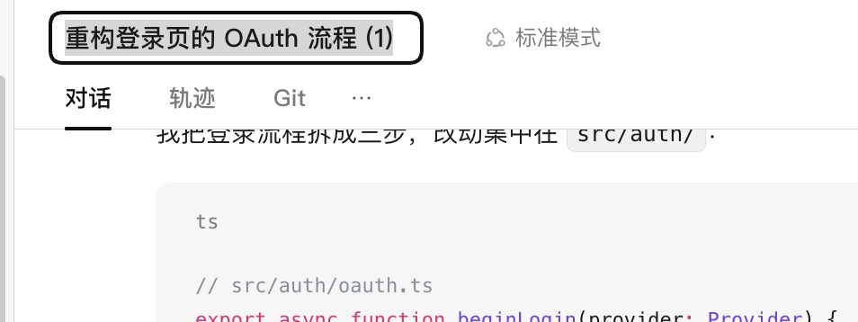
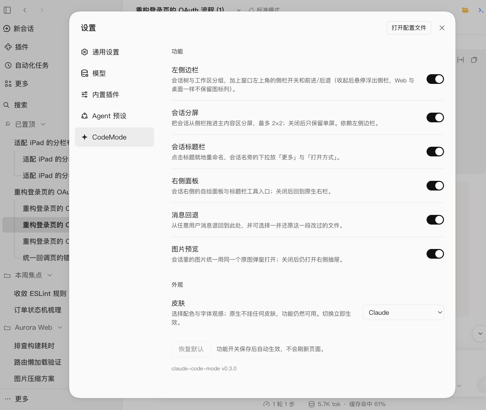

<div align="center">

# claude-code-mode

**A session workspace for DeepSeek Harness, modeled on the Claude app.**

<a href="https://www.npmjs.com/package/claude-code-mode"></a>
<a href="https://github.com/little-thing/claude-code-mode/stargazers"></a>
<a href="https://opensource.org/licenses/MIT"></a>
<a href="https://www.npmjs.com/package/@deepseek-ai/dsh?activeTab=versions"></a>

English · <a href="./README_ZH.md">简体中文</a>

</div>

<div align="center">
  <video src="https://github.com/user-attachments/assets/d6eb91bd-b836-41ce-af9d-90cd9acd4bf1" muted autoplay loop playsinline controls width="100%"></video>
</div>

DSH keeps every session as an independent row in a flat list. A fork looks like any other conversation, and comparing two sessions means switching back and forth.

claude-code-mode gives that list the structure of the Claude app: sessions remember where they came from, several can stay visible at once, and each carries its own tools. Everything DSH already does keeps working — the plugin changes how sessions are organised and presented, not what the host can do.

**New in 0.3.3 — [safety guardrails](#safety-guardrails).** A built-in deterministic check that runs before any model-based review. Dangerous operations — deleting critical directories, `curl | bash`, destructive git commands, or overwriting protected paths — are never silently allowed: each match requires your confirmation. Details below; the [changelog](CHANGELOG.md) lists the full release.

## Features

| | |
|---|---|
| **Session tree**<br/>Forked sessions stay attached to their source, and a fork of a fork still hangs under the same root, so a line of work reads as one continuous tree. Collapsed branches keep their parent visible with a count of what is hidden.<br/> | **Split view**<br/>Up to four sessions on one screen, arranged in two columns and two rows. Each pane is a complete session with its own composer, scroll position and right rail, and the layout survives a reload.<br/> |
| **Pins and sections**<br/>Pin the sessions you return to most. Sections are groups that cut across projects, so sessions from different repositories can sit in one place without being moved out of their project.<br/> | **Right rail**<br/>Files, editor, terminal, Git, browser and session diagnostics live in a rail bound to the session rather than to the window. Panels can be split, maximized and rearranged, and every pane in split view keeps its own rail.<br/> |
| **Views and sorting**<br/>Group sessions by folder, date, status, or not at all; sort by last update, creation date or name in either direction. Archived sessions can be shown or hidden, and each group remembers its own view.<br/> | **Message rewind**<br/>Return to any user message and continue from there. The session log is left untouched, and files changed in the rewound range can be restored when nothing has touched them since.<br/> |
| **Search and new sessions**<br/>One palette searches sessions, projects, automations and actions. Unsent drafts survive switching sessions and follow you when you start a session in another project.<br/> | **Image preview**<br/>Every image inside a session — tool output, collapsed summaries, message links and delivered files — opens in the same full-size lightbox.<br/> |
| **Session actions**<br/>Rename in place, fork, archive, delete, copy the session ID, and browse every session in a full page with active and archived tabs.<br/> | **Skins**<br/>A light and a dark skin modeled on the Claude app. The skin is a separate layer: switch it off and every feature keeps working in DSH's native look.<br/> |

**Also**: a settings page with a switch per feature (sidebar, split view, session header, right rail, message rewind, image preview — all on by default) · background jobs with running and completed groups · window controls for the sidebar, back and forward · `mcp_tool_search`, which keeps MCP tools out of the model context until they are needed · a shimmer on sessions that are still running.

### Safety guardrails

A built-in deterministic check that runs before any model-based review. It inspects shell commands and file writes, and it does not rely on model judgement: a match requires your confirmation instead of being silently allowed.

It covers dangerous operations: deleting critical directories (the home directory, the filesystem root, a top-level directory, or the working directory and its ancestors), `curl | bash`, destructive git commands (`git push --force`, `git clean -fdx`, `git filter-branch`), and writes to protected paths such as `~/.zshrc`, `~/.ssh`, `.git` and `.mcp.json`.

Variables are proved, not guessed. A delete target is blocked only when an empty value would land on `/` or a top-level directory: `rm -rf "$DIR"/*` is blocked, while `rm -rf "${DIR:?}"/*` is allowed because an empty value aborts the command.

A match asks you once for that call; with the unattended (`never`) approval policy it is refused without a prompt. Rejections are recorded with the command text redacted and shown as a read-only "recently blocked" list in **Settings → claude-code-mode → Safety guardrails**. Repeated attempts raise a hint there, never an automatic allow.

It is a command-and-write check, not a sandbox: code that a script or program runs internally, without issuing a shell command or a file write, is outside its view. DSH's sandbox remains the layer that constrains the process.

Optional configuration:

```yaml
dangerGuard:
  enabled: true          # on by default; false turns the guard off
  protectedPaths: []     # extra absolute paths to protect
```

## Settings

Every feature can be turned off in **Settings → claude-code-mode**. Switches are grouped by what you see — the sidebar, split view, the session header, the right rail, message rewind and image preview — so a single switch can cover several related behaviours. Turning one off hands that part of the interface back to DSH. The skin picker lives in the same section and offers the Claude skin or DSH's native look.

## Install

**Web profile:**

```bash
dsh plugin --profile web add claude-code-mode@latest
```

**Desktop app:**

Open **Plugins → Add plugin** in the app and enter `claude-code-mode`. The desktop app owns its profile, so `dsh plugin --profile desktop` is rejected on the command line.

Restart DSH if the plugin does not load by itself, then refresh the page.

Requires DSH **0.2.2-rc.1** or newer; older hosts are rejected at install time.

## Compatibility

| DSH version | Status |
|---|---|
| `0.2.2-rc.1` and newer | Supported |
| `< 0.2.2-rc.1` | Rejected at install time |

## Changelog

See [CHANGELOG.md](CHANGELOG.md) — 0.3.3 adds deterministic safety guardrails.

## License

MIT.

---

<div align="center">
  <sub>Built for the <a href="https://github.com/deepseek-ai/deepseek-harness">DeepSeek Harness</a> ecosystem · <a href="https://github.com/little-thing/claude-code-mode">github.com/little-thing/claude-code-mode</a></sub>
</div>
