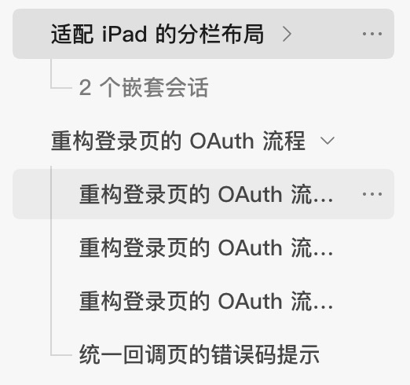
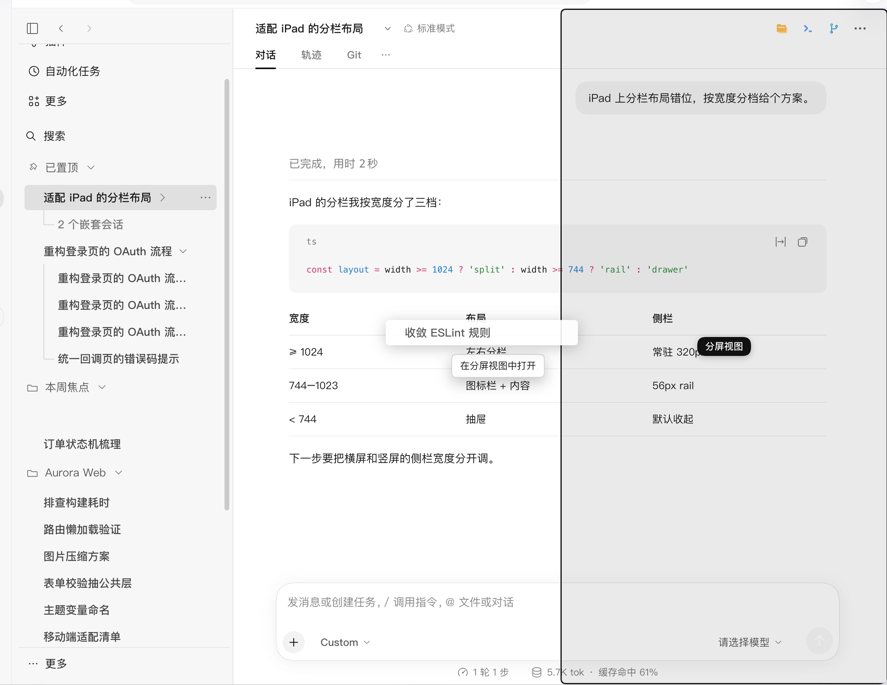
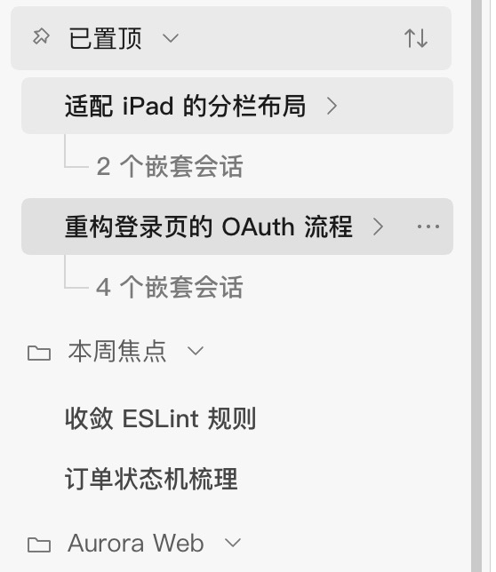
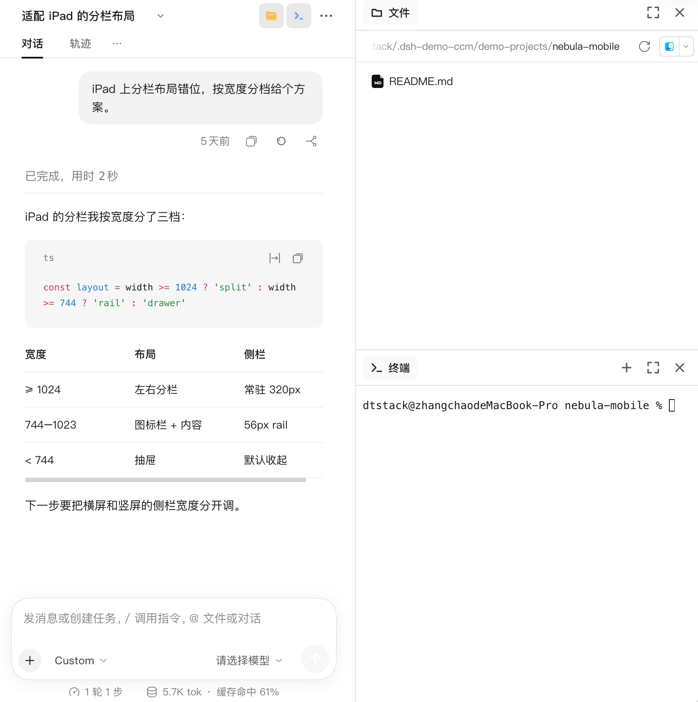
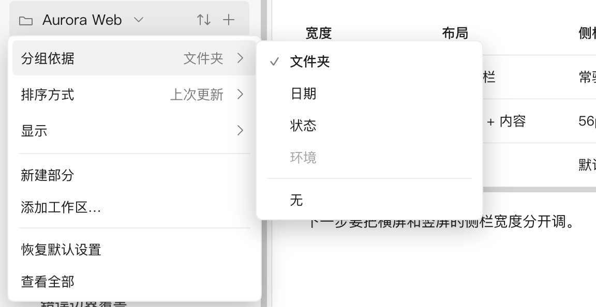
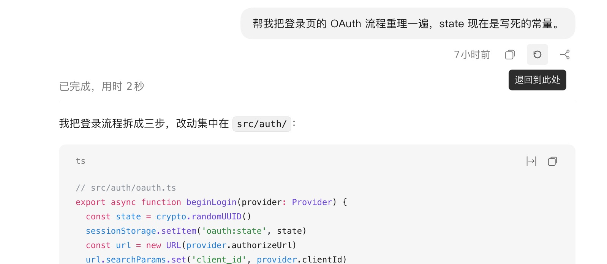
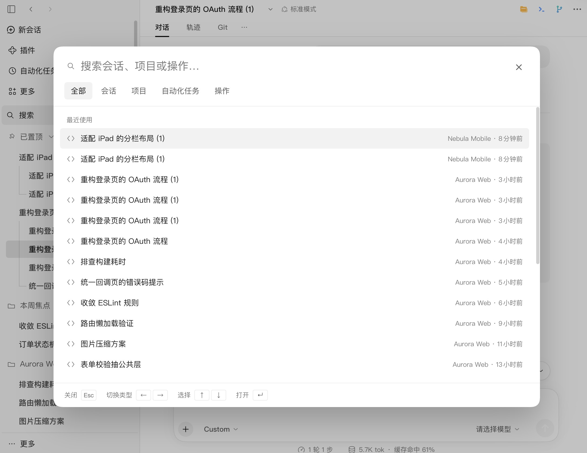
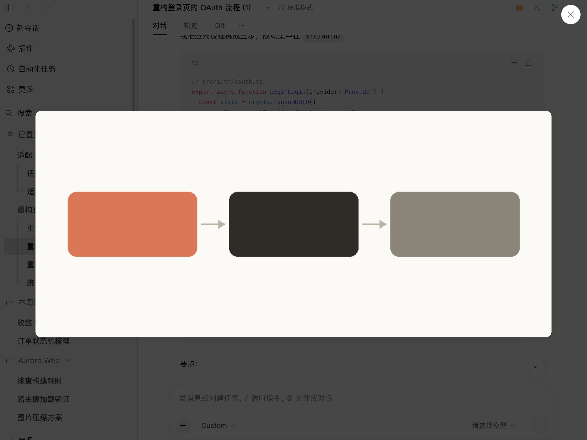
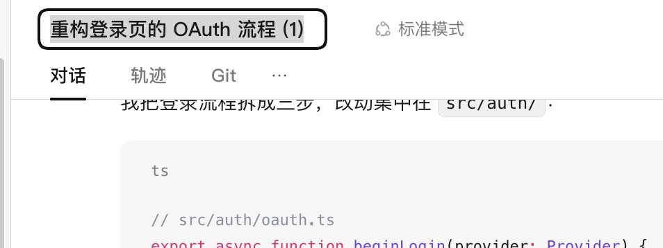
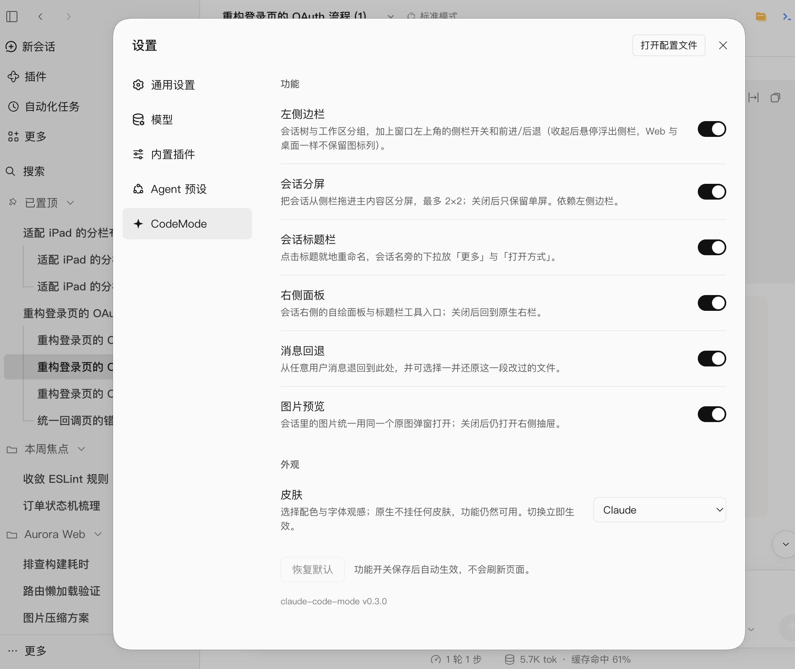

<div align="center">

# claude-code-mode

**为 DeepSeek Harness 打造的会话工作区，界面参照 Claude 应用。**

<a href="https://www.npmjs.com/package/claude-code-mode"></a>
<a href="https://www.npmjs.com/package/claude-code-mode"></a>
<a href="https://github.com/little-thing/claude-code-mode/actions/workflows/ci.yml"></a>
<a href="https://github.com/little-thing/claude-code-mode/stargazers"></a>
<a href="https://opensource.org/licenses/MIT"></a>
<a href="https://www.npmjs.com/package/@deepseek-ai/dsh?activeTab=versions"></a>

<a href="./README.md">English</a> · 简体中文

</div>

<div align="center">
  <video src="https://github.com/user-attachments/assets/d6eb91bd-b836-41ce-af9d-90cd9acd4bf1" muted autoplay loop playsinline controls width="100%"></video>
</div>

DSH 把每个会话当作扁平列表里的一条独立记录：分叉出来的会话看起来和别的对话没有区别，想同时看两个会话，只能来回切换。

claude-code-mode 把这份列表换成 Claude 应用那样的结构：会话保留来源关系，多个会话可以同时显示，每个会话带着自己的工具。DSH 原有的能力全部保留 —— 插件改变的是会话如何组织和呈现，不是宿主能做什么。

## 功能

| | |
|---|---|
| **会话树**<br/>fork 出来的会话挂在来源下面，fork 再 fork 也回到同一根行，一支工作长成一棵连续的树。折叠后父行仍然可见，并标出被收起的会话数量。<br/> | **分屏**<br/>一屏最多四个会话，按两列两行排布。每一屏都是完整会话，有自己的输入框、滚动位置和右栏；布局在刷新后保留。<br/> |
| **置顶与分区**<br/>把常用的会话固定在最上面。分区是跨项目的分组，不同仓库的会话可以放在一起，而不必离开各自的项目。<br/> | **右栏**<br/>文件、编辑器、终端、Git、浏览器和会话诊断都在属于会话而不是窗口的右栏里。面板可以分栏、最大化和重新排列，分屏时每一屏各自保留自己的右栏。<br/> |
| **视图与排序**<br/>按文件夹、日期、状态或不分组建视图；按上次更新、创建日期或名称正序或倒序排列。归档会话可以选择显示或隐藏，每个分组记住自己的视图。<br/> | **消息回退**<br/>回到任意一条用户消息，从那里继续对话。会话日志不会被改写；如果回退范围内的文件此后没有被改动过，可以一并还原。<br/> |
| **搜索与新建**<br/>一个搜索入口覆盖会话、项目、自动化和操作。未发送的草稿在切换会话后保留，换一个项目新建时也能一起带过去。<br/> | **图片预览**<br/>会话里的图片 —— 工具输出、折叠摘要、消息里的链接和交付文件 —— 都在同一个原尺寸灯箱里打开。<br/> |
| **会话操作**<br/>就地重命名、分叉、归档、删除、复制 Session ID，以及在完整会话页里按活跃和已归档浏览全部会话。<br/> | **皮肤**<br/>一套参照 Claude 应用的浅色和深色皮肤。皮肤是独立的一层：关掉它，所有功能照常工作，只是回到 DSH 原生观感。<br/> |

**还有**：设置页里每个功能一个开关（侧栏、分屏、会话 header、右栏、消息回退、图片预览，默认全开）· 后台任务按运行中和已完成分区 · 侧栏开关与前进/后退的窗口控件 · `mcp_tool_search` 让 MCP 工具在需要时才进入模型上下文 · 运行中的会话带扫光。

## 设置

每个功能都能在 **设置 → claude-code-mode** 里单独关掉。开关按用户看到的部分分组 —— 侧栏、分屏、会话 header、右栏、消息回退、图片预览 —— 一个开关可以覆盖几项相关行为。关掉之后，那部分界面交还给 DSH。皮肤选择器也在同一处，可以选 Claude 皮肤或 DSH 原生观感。

## 安装

**Web profile：**

```bash
dsh plugin --profile web add claude-code-mode@latest
```

**桌面端：**

```bash
dsh plugin --profile desktop add claude-code-mode@latest
```

先打开一次 DeepSeek Harness Desktop 让它初始化 profile，然后退出应用再执行。

如果插件没有自动加载，重启 DSH，再刷新页面。

需要 DSH **0.2.2-rc.1** 或更高版本，更低版本会在安装时被拒绝。

<details>
<summary><b>从源码安装</b></summary>

```bash
git clone https://github.com/little-thing/claude-code-mode.git
cd claude-code-mode
pnpm install && pnpm build
dsh plugin --profile web add file:$PWD   # 或 --profile desktop
```

</details>

## 兼容性

| DSH 版本 | 状态 |
|---|---|
| `0.2.2-rc.1` 及更新 | 支持 |
| `< 0.2.2-rc.1` | 安装时拒绝 |

## 开发

<details>
<summary><b>构建与测试</b></summary>

```bash
pnpm install
pnpm build
node --test test/mcp-tool-search/*.test.mjs test/theme/*.test.mjs
```

</details>

## License

MIT。

---

<div align="center">
  <sub>为 <a href="https://github.com/deepseek-ai/deepseek-harness">DeepSeek Harness</a> 生态而做 · <a href="https://github.com/little-thing/claude-code-mode">github.com/little-thing/claude-code-mode</a></sub>
</div>
